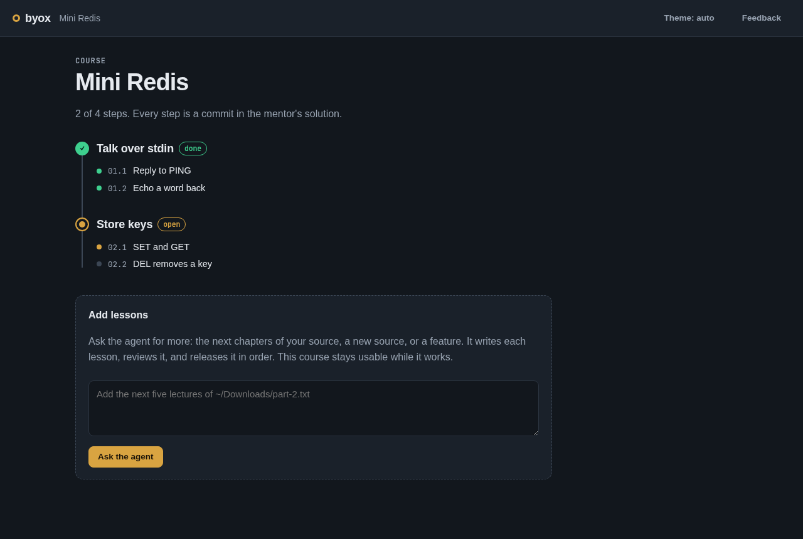
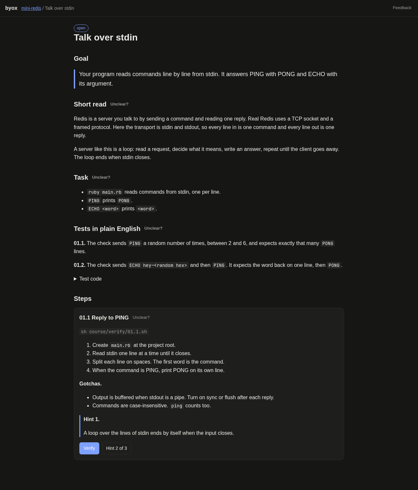

# byox

Turn any tutorial you own into a CodeCrafters-style course you build line by line.

[](LICENSE)
[](https://code.claude.com/docs/en/plugins)




## About

Watching a course feels like learning. Then an interviewer asks what you built, and there is nothing to show. CodeCrafters fixed that for a few projects by cutting everything except the code: a task, a test, a green check. But it is paid, it has no frontend or cloud tracks, and it cannot use the material you already have.

byox is **Build Your Own X mode** for [Claude Code](https://code.claude.com). Give it a source you have, such as a recorded mentor session, a Udemy transcript, an open source repo's early history, or a Build Your Own X article. It compiles a local course: lessons in the source's order, a test for every step, and a site with a Verify button. You write every line. The agent never writes your solution.

## Features

- **Any source.** Transcripts (matched to the mentor's repo when one exists), repo history grouped into lessons, or articles.
- **A test for every step, proven.** Each step's test must fail on the mentor's code before the step and pass after it. A script checks this, so a weak test never ships.
- **Lessons that teach, not just tell.** A short read, the precise task, what the check does in plain English, ordered steps without code, and three hints revealed one at a time.
- **Real reading, not reference docs.** Each lesson points at the exact section of a human-written article or guide. Optional deep-dive concept pages build the idea up diagram by diagram.
- **Written twice.** One agent writes each lesson. A second agent builds it as a learner from the page alone, scores it, and fixes what it finds.
- **Frontend steps arrive as a design.** The agent designs the step in [Penpot](https://penpot.app), the open source Figma alternative, through its official MCP server, and hands you the file plus desktop and phone targets. Verify screenshots your page and shows where it differs in red. Without Penpot connected, it falls back to a plain HTML design you open and inspect.
- **Cloud and DevOps steps run the real CLI.** A bash check per step, boot.dev style, prints what passed and what it expected against what it got. It runs against your cloud account or a free local emulator.
- **Ported to today's stack.** A Rails 6 course can become a Rails 8 course. The step tests prove the port behaves the same.
- **Stuck help that never cheats.** Explain failure runs a coach that cannot read the solution or your unrevealed hints.
- **A workbench that keeps your place.** Continue where you left off, a light or dark theme that sticks, and an **Add lessons** box that asks the agent for more chapters or a new feature without taking your course offline.
- **It learns from how you use it.** `/byox-optimize` reads every course across every stack, your notes, open feedback, lint results and your own Claude Code sessions. Two read-only reviewers and a synthesizer turn that into specific edits to byox, and nothing is applied until you approve it.
- **Progress in Obsidian.** Concept pages, a weakness log and your progress can live in your vault.
- **Feedback straight to a pull request.** Tell byox what to change, or change it yourself, and the feedback agent opens one pull request with before and after screenshots.

## Requirements

- [Claude Code](https://code.claude.com)
- Ruby 3.4 or newer. byox uses only the standard library, so there are no gems to install.
- Git
- Optional, for feedback pull requests: the [GitHub CLI](https://cli.github.com) (`gh`) and [Playwright](https://playwright.dev), or any Chrome or Chromium for screenshots.

## Installation

In Claude Code:

```
/plugin marketplace add da5ater/byox
/plugin install byox@byox
```

## Usage

### Compile a course

Name the source, the language and the stack in your own words. byox asks only for what you leave out.

```
/byox-mode this transcript ~/Downloads/my-course-transcript.txt, Rails 8, Minitest
/byox-mode this repo https://github.com/sidekiq/sidekiq, cut off at v0.5.0
/byox-mode this article https://example.com/build-your-own-redis
```

byox proposes an outline and asks, per paid service such as Stripe or AWS, whether to use a real account, a free tier or a stub. It waits for your approval, then writes the course.

### Take a course

```
/byox-mode start
```

This opens the site at http://127.0.0.1:4917. The loop:

1. Read the lesson.
2. Write the code in your own editor.
3. Press **Verify**. Green unlocks the next step. Your code goes in the project's `work/` folder.
4. Stuck? Reveal a hint, or press **Explain failure**.
5. A green lesson unlocks the mentor's solution and a diff against your code.

### Add more lessons later

Press **Add lessons** on a course page and say what you want: the next chapters of your source, a new source, or a feature. The agent writes each new lesson, has a second agent review it, and releases them in order. Lessons that are still being written show as "being written" and stay locked.

### Improve byox from your own use

After you have worked through some lessons, or after a compile that went badly, run `/byox-optimize`. It gathers the evidence with `byox evidence` and `byox transcripts`, which redact keys and read only this project's sessions. Then a friction reviewer and a pipeline reviewer judge it. A synthesizer checks every citation and returns Accepted, Rejected and Backlog lists. You approve a subset, and byox edits itself on a branch, test first. Backlog items land in the site's Feedback list.

### What a lesson contains

| Section | What it gives you |
|---|---|
| Goal | What works when you finish, in two lines |
| Short read | About two minutes on why, rewritten from the source with the rambling removed |
| Task | The precise spec |
| Tests in plain English | What the check sends and what it expects |
| Steps | Ordered instructions without code, three hints and a Verify button |
| Resource | One article or guide, at the exact section |
| Go deep | Concept pages for the ideas the lesson uses |
| Mentor's solution | Locked until the lesson is green or skipped |



### Frontend and cloud steps

- **Frontend.** With Penpot connected (a free account, an MCP key, and the file open in a browser tab), the agent builds each step as a Penpot file with named tokens and links it from the lesson. Otherwise each step ships `course/design/<step>/design.html`, a self-contained design with its colors, type and spacing in CSS variables. The lesson shows the desktop and phone targets either way. Verify starts your app, takes screenshots with headless Chrome and compares them, and prints the percentage of pixels that differ. `byox shot` and `byox visual-diff` are the two tools behind it. Penpot draws text differently from Chrome, so those steps compare 8px block averages (`--coarse 8`) and still catch wrong colors and layout.
- **Cloud and DevOps.** Each step ships a bash script that runs the real CLI and checks its output. The AWS CLI reads `AWS_ENDPOINT_URL`, so the same script works against a free local emulator such as [Floci](https://github.com/floci-io/floci), which needs no account, and against real AWS.

## Where things live

A project is a folder with two folders in it:

```
~/byox-courses/corsego/
  course/       the agent's lessons, tests, solution and your progress
  work/
    api/        your Rails API, with its own git repo
    frontend/   your React app, with its own git repo
```

`work/` holds only your code, so you can search and edit it freely without course files in the way. A product with one codebase uses `work/` itself. A course with several, like an API and a frontend, decides the folders before the first lesson and names them in every step. `course/` is the agent's, and you never need to open it. Courses made with an older version keep your app in the project folder itself, and byox still runs them. Convert one with `byox migrate <project> --dry-run`, then without the flag. To split `work/` into named projects, add `--projects api,frontend`.

## Configuration

Courses live under a root folder: the `--root` flag, else `BYOX_ROOT`, else `~/byox-courses`. An optional `byox.yml` in that folder sets the rest.

```yaml
vault: ~/Obsidian/MyVault/byox     # concept pages and progress notes. Default: <root>/vault
agent_cmd: claude -p               # the headless agent behind the site's buttons
upstream: da5ater/byox             # where feedback pull requests go
plugin_repo: ~/code/byox           # your local checkout of byox, for uploading your own changes
```

## Feedback and contributing

byox improves from the people who use it. There are two ways to send a change, and both end in one pull request on this repo with before and after screenshots and steps to try it.

- **Say what should change.** Press **Feedback** on any page of the site, or tell Claude `/byox-mode I have feedback`. When you are ready, press **Send to a pull request** and the feedback agent makes the changes.
- **Change it yourself.** Edit your checkout of byox as you go, set `plugin_repo` in `byox.yml`, then say `/byox-mode upload my feedback` or press **Upload my changes**. The agent packages your work. It does not rewrite it.

If you cannot push to this repo, the agent opens the pull request from your fork. Nothing is merged without review. Pull requests by hand are welcome too.

### Development

```bash
git clone https://github.com/da5ater/byox && cd byox
ruby plugins/byox/skills/byox-mode/scripts/test/run.rb
```

Try the site on a small example course, a two-lesson Redis clone over stdin:

```bash
ruby plugins/byox/skills/byox-mode/scripts/test/fixtures/make_mini_redis.rb /tmp/byox-demo
ruby plugins/byox/skills/byox-mode/scripts/byox site --root /tmp/byox-demo
```

The plugin lives in `plugins/byox/`. `skills/byox-mode/` holds the entry skill, its playbooks and references, and the `byox` executable. `agents/` holds the lesson writer, the lesson reviewer, the course auditor, the coach and the feedback agent.

## Roadmap

- A frontend course compiled from an open source repo, with design checks against its Storybook.
- Cloud and DevOps lessons verified by CLI scripts.
- Shareable compiled courses, so one person's compile helps everyone with the same source.

## Acknowledgments

- [CodeCrafters](https://codecrafters.io) and [shipthatcode](https://shipthatcode.com), for showing how far a task, a test and a green check can go.
- [Build Your Own X](https://github.com/codecrafters-io/build-your-own-x), for the idea in the name.
- The `byox-teach` skill is adapted from the teach skill in [pstack](https://github.com/michael-denyer/pstack-claude) by Lauren Tan and Michael Denyer, under the MIT license.

## License

byox is licensed under the MIT license. See [`LICENSE`](LICENSE).
